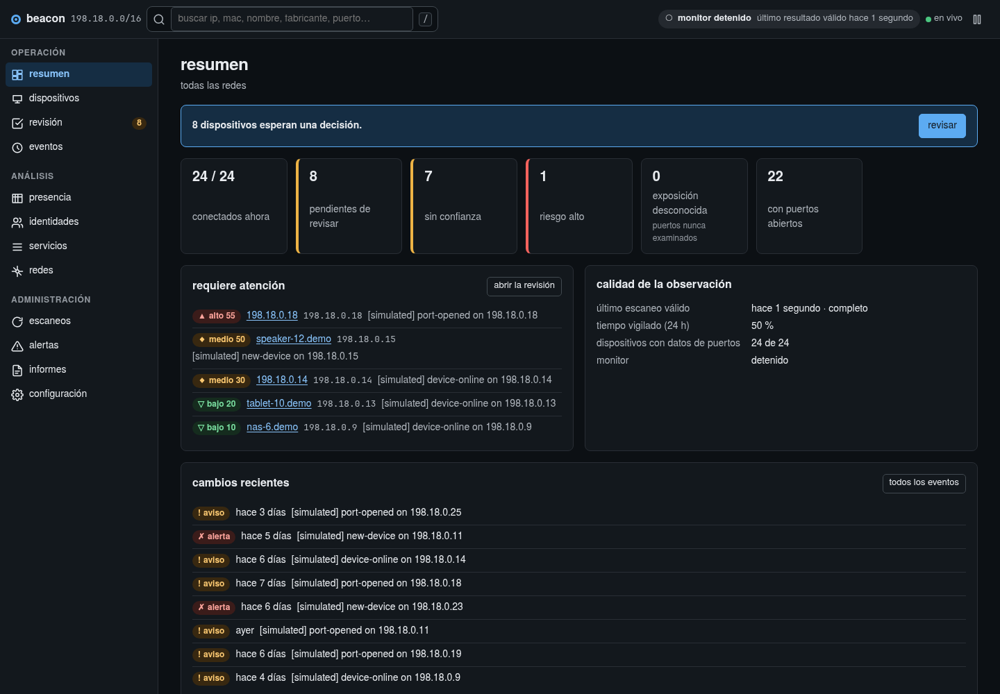
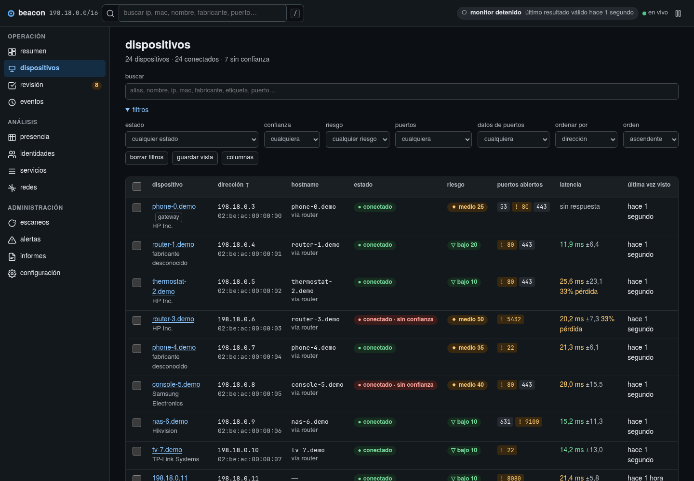

<div align="center">

# BEACON

**conoce tu red. reconoce tus dispositivos. entiende cada cambio.**

inventario y monitorización de la red local, con aplicación web en vivo, terminal e informes que puedes llevar contigo.

[](https://github.com/rezzt-dev/beacon-project/actions/workflows/ci.yml)


[](license.md)

[primeros pasos](#primeros-pasos) · [capturas](#un-vistazo) · [guía de uso](#guia-de-uso) · [documentación](#documentacion) · [english](#english)

</div>

---

## QUE ES BEACON

beacon descubre los dispositivos de tu red local, reúne lo que puede observar de ellos y conserva su historia en una base de datos local. te ayuda a responder cuatro preguntas: **qué hay conectado, qué ha cambiado, qué merece atención y qué puedes hacer después**.

puedes identificar un equipo desconocido, ponerle un alias, revisar sus servicios y puertos, seguir su presencia y recibir avisos cuando cambie algo relevante. cada valoración de riesgo muestra sus motivos y distingue las observaciones de las inferencias y de los datos que faltan.

<table>
<tr>
<td width="33%" valign="top">

<strong>aplicación en vivo</strong>

navega por el inventario, revisa avisos, consulta el historial y configura escaneos y alertas desde el navegador.

<code>uv run beacon live</code>

</td>
<td width="33%" valign="top">

<strong>terminal y automatización</strong>

descubre dispositivos, consulta su estado y exporta resultados estructurados para tus propios scripts.

<code>uv run beacon scan -p top</code>

</td>
<td width="33%" valign="top">

<strong>informes portátiles</strong>

genera un informe html autónomo de solo lectura que se abre sin conexión y sin instalar beacon en el equipo receptor.

<code>uv run beacon export informe.html</code>

</td>
</tr>
</table>

las tres experiencias comparten inventario y reglas. el servidor web y sus recursos vienen incluidos en el paquete; no necesitas node para instalar ni utilizar beacon.

## UN VISTAZO

<a href=".docs/assets/beacon-overview.png"></a>

<p align="center"><sub>aplicación real con datos simulados. las direcciones y los dispositivos de estas capturas no pertenecen a una red personal.</sub></p>

<details>
<summary>ver el inventario de dispositivos</summary>

<a href=".docs/assets/beacon-devices.png"></a>

</details>

## CONTENIDO

- [primeros pasos](#primeros-pasos)
- [guía de uso](#guia-de-uso)
- [capacidades y criterios de interpretación](#capacidades-y-criterios-de-interpretacion)
- [datos, privacidad y acceso](#datos-privacidad-y-acceso)
- [mantenimiento](#mantenimiento)
- [compatibilidad y límites](#compatibilidad-y-limites)
- [solución de problemas](#solucion-de-problemas)
- [desarrollo y validación](#desarrollo-y-validacion)
- [documentación](#documentacion)
- [licencia y contacto](#licencia-y-contacto)
- [english](#english)

## PRIMEROS PASOS

### REQUISITOS

- python **3.11 o superior** y git para obtener el código.
- `uv` instalado, o `pip` dentro de un entorno virtual si prefieres esa alternativa.
- un navegador para la aplicación live o los informes html; la cli funciona sin él.
- acceso a la red local que quieras observar. el modo sin privilegios permite empezar sin permisos de administrador.

> [!IMPORTANT]
> el repositorio se publica con todos los derechos reservados. las instrucciones de instalación y uso están dirigidas a quienes cuenten con permiso del titular, conforme a [`license.md`](license.md). escanea únicamente redes propias o para las que tengas autorización expresa.

### 1. INSTALA EL PROYECTO

```bash
git clone https://github.com/rezzt-dev/beacon-project.git
cd beacon-project
uv sync --locked
uv run beacon --version
```

opcionalmente, descarga el catálogo de fabricantes para identificar los prefijos mac:

```bash
uv run beacon vendors update
```

esta operación descarga la base oui de wireshark. después, la consulta de fabricantes se realiza sin conexión; puedes empezar sin descargarla, con menos información de identificación.

<details>
<summary>alternativa con pip</summary>

desde la raíz del repositorio, crea y activa un entorno virtual:

```bash
python -m venv .venv
```

linux o macos:

```bash
source .venv/bin/activate
```

windows, en powershell:

```powershell
.venv\Scripts\Activate.ps1
```

instala y comprueba:

```bash
python -m pip install -e .
beacon --version
beacon live
```

en los ejemplos siguientes, sustituye `uv run beacon` por `beacon` si utilizas este método, manteniendo el entorno activo.

</details>

### 2. ABRE LA APLICACION

```bash
uv run beacon live
```

beacon inicia el servidor en `http://127.0.0.1:8765` y abre el navegador mediante un enlace privado de acceso. el asistente inicial te permite elegir la interfaz de red, descubrir los equipos y seleccionar cuáles reconoces. revisa esa selección antes de marcarlos como confiables.

para detener el servidor, pulsa `Ctrl+C` en la terminal. si el navegador no se abre, utiliza el enlace que aparece en ella. una vez iniciado el servidor, puedes recuperar el enlace desde otra terminal con `uv run beacon live --url`.

### 3. EXPLORA CON DATOS SIMULADOS

si prefieres conocer la interfaz antes de escanear tu red, crea una base independiente:

```bash
uv run beacon demo beacon-demo.db
uv run beacon --db beacon-demo.db live
```

el generador crea dispositivos, eventos, sesiones e historial simulados y rechaza un archivo de destino que ya exista. la generación no escanea la red. para volver a tu inventario habitual, detén el servidor y ejecuta `uv run beacon live` sin `--db`.

## GUIA DE USO

los comandos se ejecutan desde la raíz del repositorio con `uv`. las direcciones de ejemplo deben adaptarse a tu red; `beacon interfaces` muestra los rangos disponibles.

### DESCUBRE TU RED

```bash
# consulta las interfaces y la red seleccionada por defecto
uv run beacon interfaces

# descubre dispositivos en la red de la interfaz predeterminada
uv run beacon scan

# examina además los 100 puertos tcp del conjunto top
uv run beacon scan -p top

# elige un rango y puertos concretos, sin permisos de administrador
uv run beacon scan 192.168.1.0/24 --mode unprivileged -p 22,80,443
```

sin `-p`, el escaneo no realiza un barrido de puertos. puedes usar `top`, `web`, `admin`, `iot`, `all`, una lista como `22,80,443` o un rango como `1-1024`. el alcance y los tiempos aumentan con el número de equipos y puertos seleccionados.

### REVISA E IDENTIFICA LOS EQUIPOS

```bash
uv run beacon devices list --risk
uv run beacon review
uv run beacon devices show 192.168.1.20

# marca como conocido un dispositivo que hayas identificado
uv run beacon devices trust 192.168.1.20 --alias "portatil"

# consulta propuestas de identidad para direcciones mac aleatorias
uv run beacon devices candidates

# consulta los avisos que siguen pendientes
uv run beacon events --pending
```

puedes referirte a un dispositivo por mac, ip, alias o hostname. desde la aplicación también puedes editar sus datos y revisar las evidencias de riesgo e identidad. una propuesta de identidad requiere confirmación; no transfiere confianza de forma automática.

### MONITORIZA LOS CAMBIOS

elige una de estas formas de mantener la observación:

```bash
# aplicación web con un escaneo cada 60 segundos
uv run beacon live --monitor 60

# monitorización desde la terminal, con puertos y un informe actualizado
uv run beacon watch -n 60 -p top -o vivo.html
```

`watch` regenera el informe después de cada escaneo y el html se actualiza al abrirlo en el navegador. la aplicación live permite ejecutar acciones y guardarlas; el informe representa una vista de solo lectura. `Ctrl+C` detiene cualquiera de los dos procesos.

para reutilizar una configuración, guarda un perfil:

```bash
uv run beacon profiles add casa --target 192.168.1.0/24 -p top --interval 60
uv run beacon profiles list
uv run beacon scan --profile casa
uv run beacon live --profile casa --monitor 60
```

cuando usas `scan --profile`, el perfil define el objetivo, los puertos, las exclusiones y los tiempos; las demás opciones de escaneo se ignoran, salvo `--no-save`. evita ejecutar dos monitores sobre el mismo alcance: beacon utiliza bloqueos temporales para impedir escaneos concurrentes.

### EXPORTA Y AUTOMATIZA

```bash
# exporta el inventario guardado; no inicia otro escaneo
uv run beacon export informe.html
uv run beacon export inventario.json
uv run beacon export inventario.csv

# escribe datos estructurados para otros programas
uv run beacon devices list --json > dispositivos.json
uv run beacon scan -p top --json > escaneo.json

# señala avisos mediante el código de salida
uv run beacon scan -p top --fail-on-alert
```

para compartir un informe con identificadores seudonimizados, utiliza las opciones de exportación de la vista de informes en la aplicación. la seudonimización oculta identificadores, pero no garantiza el anonimato.

| código de `scan` | significado |
|---|---|
| `0` | ejecución completada sin activar una condición de salida por alertas. |
| `1` | error de ejecución, objetivo o permisos. |
| `2` | argumentos u opciones no válidos. |
| `3` | se cumplió la condición de `--fail-on-alert` o `--fail-on-risk`. |
| `4` | otro proceso está escaneando el mismo alcance. |
| `130` | interrupción desde el teclado. |

### CONSULTA LA AYUDA

```bash
uv run beacon --help
uv run beacon scan --help
uv run beacon devices --help
uv run beacon live --help
```

las opciones globales, como `--db` y `--verbose`, se escriben **antes** del subcomando: `uv run beacon --db beacon-demo.db devices list`.

## CAPACIDADES Y CRITERIOS DE INTERPRETACION

| capacidad | qué aporta |
|---|---|
| **descubrimiento** | barrido arp con scapy cuando hay privilegios; sin ellos, icmp, tabla arp del sistema y confirmación tcp. descubre vecinos ipv6 desde la tabla ndp, sin recorrer un `/64`. |
| **identificación** | fabricante por oui local, detección de mac aleatoria, resolución de nombres mediante dns, mdns y netbios, servicios mdns y estimación de sistema operativo por ttl. |
| **servicios y certificados** | banners y handshakes tls para distinguir protocolos observados de los inferidos por el número de puerto. registra sujeto, emisor, nombres y validez de certificados. |
| **riesgo explicable** | puntuación con motivos, evidencias y fechas. distingue observación, inferencia, historia y contexto; la falta de datos deja la valoración incompleta. |
| **revisión guiada** | cola ordenada por riesgo para confiar, revisar sin confiar, posponer o eliminar del inventario. |
| **identidad continua** | propuestas con evidencias para reconocer equipos que cambian de mac privada; puedes confirmarlas o rechazarlas. |
| **presencia** | sesiones, mapa semanal y anomalías calculadas sobre las horas observadas, con zona horaria configurable. |
| **historial y redes** | inventarios separados según la red y el router; escaneos completos, incompletos, fallidos o cancelados, con etapas, errores, latencia, pérdida y comparación de alcance. |
| **alertas configurables** | políticas por tipo, gravedad, dispositivo y riesgo; umbrales, enfriamiento, silencios y mantenimiento. canales de escritorio o webhook firmado con reintentos acotados. |
| **operación local** | perfiles, copias coherentes, restauración verificada, retención con vista previa, servicio de usuario y registro de diagnóstico. |

> [!NOTE]
> un timeout no demuestra que un puerto esté cerrado. un puerto no examinado conserva esa distinción. un certificado observado no implica que sea de confianza, y la puntuación de riesgo sirve para priorizar la revisión: no certifica la seguridad de un equipo.

la escucha pasiva de arp, dhcp y mdns es opcional y necesita privilegios. puedes consultar sus opciones con `uv run beacon listen --help`.

## DATOS, PRIVACIDAD Y ACCESO

### DONDE SE GUARDA EL INVENTARIO

beacon conserva los datos en sqlite. ejecuta `uv run beacon status` para ver la ruta efectiva, los contadores y las capacidades disponibles.

| sistema | directorio predeterminado |
|---|---|
| linux | `$XDG_DATA_HOME/beacon`, o `~/.local/share/beacon` si no está definido. |
| macos | `~/Library/Application Support/beacon`. |
| windows | `%LOCALAPPDATA%\beacon`. |

la base se llama `beacon.db`. puedes cambiar el directorio con `BEACON_HOME`, la base con `BEACON_DB` o seleccionar un archivo mediante `--db`. la opción `--db` tiene prioridad sobre `BEACON_DB`.

### QUE TRAFICO GENERA

no necesitas una cuenta en la nube. los escaneos y las consultas de identificación generan tráfico para descubrir y reconocer equipos; `vendors update` descarga el catálogo de fabricantes. los canales de notificación solo envían datos cuando los configuras.

los informes excluyen por defecto información sensible como presencia, huellas de identidad, notas y responsable; las inclusiones disponibles dependen del formato y del método de exportación. revisa el contenido antes de compartirlo.

### COMO SE PROTEGE LA APLICACION

el servidor escucha en loopback por defecto. utiliza un enlace privado de acceso, sesiones firmadas, cookies `HttpOnly` y `SameSite=Strict`, protección csrf, validación de `Host` y `Origin`, límites de tamaño y frecuencia y una política csp sin recursos remotos ni código en línea.

- conserva el enlace de acceso en privado: quien lo tenga puede iniciar sesión.
- `uv run beacon live --rotate-token --url` invalida enlaces y sesiones anteriores y muestra el nuevo enlace. si el servidor ya estaba activo, reinícialo para que cargue el cambio.
- escuchar fuera de loopback requiere `--allow-lan`. las opciones `--tls-cert` y `--tls-key` permiten servir mediante https.
- los escaneos iniciados desde la web se limitan a rangos privados de tamaño `/16` o menor, definidos en perfiles.

consulta [privacidad y seguridad](.docs/project-info/evolucion/privacidad-y-seguridad.md) para conocer los controles y sus límites.

## MANTENIMIENTO

```bash
# crea y verifica una copia coherente de la base
uv run beacon backup copia-beacon.db

# previsualiza lo que eliminaría la política de retención
uv run beacon retention

# aplica la política configurada
uv run beacon retention --apply
```

para restaurar una copia, detén antes los procesos `live` y `watch`. el comando pide confirmación y conserva la base anterior como `.before-restore`:

```bash
uv run beacon restore copia-beacon.db
```

<details>
<summary>ejecución como servicio de usuario</summary>

previsualiza la definición antes de instalarla:

```bash
uv run beacon service show --interval 300
uv run beacon service install --interval 300 --enable
uv run beacon live --url
```

en linux se usa un servicio de usuario de systemd y en macos un agente de launchd. en windows el comando muestra una instrucción para crear una tarea de inicio de sesión; no la ejecuta automáticamente. conserva el entorno de python donde instalaste el servicio, ya que su definición apunta a ese intérprete.

```bash
uv run beacon service uninstall
```

consulta [operación](.docs/project-info/evolucion/operacion.md) para perfiles, diagnóstico, alertas y mantenimiento.

</details>

## COMPATIBILIDAD Y LIMITES

beacon **0.2.0 está en desarrollo**. el soporte previsto y lo verificado se distinguen a continuación:

| entorno | evidencia disponible |
|---|---|
| linux con python 3.13 | validación local documentada: pruebas unitarias, cli, api, navegador chromium e instalación del wheel. |
| linux con privilegios | analizadores probados con paquetes construidos; barrido arp y captura pasiva pendientes de verificación en vivo con root. |
| linux, macos y windows con python 3.11, 3.12 y 3.13 | matriz configurada en [integración continua](.github/workflows/ci.yml); consulta sus ejecuciones para conocer el resultado remoto. |

la visibilidad depende de la interfaz, los permisos, el firewall y la respuesta de cada dispositivo. los vecinos ipv6 proceden de la tabla del sistema. las mac aleatorias pueden fragmentar el historial hasta que confirmes una identidad, y las anomalías de presencia necesitan observación suficiente.

<details>
<summary>previsto, todavía no disponible</summary>

- escaneo syn con scapy en modo privilegiado.
- interfaz de terminal a pantalla completa con textual.
- calibración de los pesos de riesgo, identidad y presencia con capturas reales.
- posible implementación de scanners en rust con pyo3 si las mediciones la justifican.

estos puntos no forman parte de las funciones disponibles en la versión actual. el estado detallado está en [seguimiento](.docs/project-info/evolucion/seguimiento.md).

</details>

## SOLUCION DE PROBLEMAS

| síntoma | qué comprobar |
|---|---|
| no se encuentran los equipos esperados | ejecuta `uv run beacon interfaces`; comprueba el rango y selecciona la interfaz con `scan --iface`. revisa también la vpn, el aislamiento de clientes y el firewall. |
| faltan permisos para el descubrimiento | empieza con `uv run beacon scan --mode unprivileged`. consulta `status` para ver las capacidades detectadas. |
| aparece un fabricante desconocido | ejecuta `uv run beacon vendors update`. una mac privada o un prefijo ausente puede seguir sin fabricante. |
| la valoración de riesgo está incompleta | ejecuta un escaneo con puertos, por ejemplo `uv run beacon scan -p top`, y revisa la cobertura y la fecha de los datos. |
| el navegador no se abre | copia el enlace privado de la terminal. `live --no-open` permite iniciar el servidor sin intentar abrir el navegador. |
| el puerto está ocupado | inicia con `uv run beacon live --port 8766`; para recuperar su enlace usa también `live --port 8766 --url`. |
| otro proceso bloquea el escaneo | consulta `uv run beacon status` y detén el monitor que esté usando ese alcance. |
| uv no puede crear el entorno en exfat o en un disco sin enlaces simbólicos | guarda el entorno fuera del repositorio con la configuración siguiente. |

para linux o macos, en una terminal bash o zsh:

```bash
export UV_PROJECT_ENVIRONMENT="$HOME/.cache/beacon/venv"
uv sync --locked
uv run beacon live
```

para obtener diagnóstico utiliza `uv run beacon --verbose status` o inicia el servidor con `uv run beacon live --log-file beacon-live.log`. antes de compartir registros, revisa si contienen direcciones o nombres de tu red.

## DESARROLLO Y VALIDACION

```bash
uv sync --locked --group dev
uv run ruff check app tests scripts
uv run pytest -q -m "not browser"
```

para ejecutar también las pruebas de navegador:

```bash
uv sync --locked --group dev --group browser
uv run python -m playwright install chromium
uv run pytest -q
```

las pruebas usan bases temporales, red simulada o servicios de loopback. para generar la distribución y medir con datos sintéticos:

```bash
uv build
uv run python scripts/bench.py
```

<details>
<summary>estructura del proyecto</summary>

```text
app/beacon/
├── cli/          # comandos y opciones de terminal
├── core/         # modelos, eventos, riesgo, identidad y presencia
├── scanners/     # descubrimiento y sondas
├── services/     # operaciones compartidas
├── storage/      # persistencia sqlite y migraciones
├── web/          # servidor, api y recursos de la aplicación
├── export/       # exportadores e informe autónomo
└── ui/           # presentación en terminal
scripts/          # arranque y medición
tests/            # pruebas de lógica, cli, api y navegador
.docs/            # arquitectura, operación y decisiones
```

</details>

## DOCUMENTACION

| recurso | contenido |
|---|---|
| [guía técnica](.docs/project-info/evolucion/readme.md) | índice de la evolución de la aplicación. |
| [arquitectura](.docs/project-info/evolucion/arquitectura.md) | capas, flujo de escaneo y concurrencia. |
| [api](.docs/project-info/evolucion/api.md) | contrato `/api/v1`, errores y actualizaciones en vivo. |
| [operación](.docs/project-info/evolucion/operacion.md) | servicio, alertas, copias, retención y diagnóstico. |
| [privacidad y seguridad](.docs/project-info/evolucion/privacidad-y-seguridad.md) | datos almacenados, tráfico y protección del acceso. |
| [rendimiento](.docs/project-info/evolucion/rendimiento.md) | metodología y resultados medidos. |
| [validación final](.docs/project-info/evolucion/validacion-final.md) | pruebas realizadas, distribución y límites pendientes. |
| [guía de la fase cli](.docs/project-info/cli-base/readme.md) | documentación específica de terminal. |
| [historial de cambios](changelog.md) | evolución del proyecto. |

## LICENCIA Y CONTACTO

© 2026 rezzt-dev. **todos los derechos reservados**. el código publicado no concede una licencia de uso, modificación o distribución. consulta las condiciones completas en [`license.md`](license.md) y contacta con [rezzt-dev](https://github.com/rezzt-dev) para solicitar permisos.

para comunicar un fallo, incluye el comando o la acción, el resultado esperado, el sistema operativo y las versiones de python y beacon. comparte solo los datos de red necesarios y evita publicar enlaces privados de acceso.

---

## ENGLISH

**discover your local network, recognize your devices and understand what changed.**

beacon combines a live web application, a command-line interface and standalone reports over the same local sqlite inventory. it discovers devices, collects names, vendors, services and certificates, records history and explains why a device deserves attention.

### INSTALL AND START

requires python **3.11+**, git and uv. a browser is needed for the live app, while the cli works without one. node is not required.

> [!IMPORTANT]
> all rights reserved. installation and usage instructions are for users with permission from the copyright holder under [`license.md`](license.md). only scan networks you own or are explicitly authorized to test.

```bash
git clone https://github.com/rezzt-dev/beacon-project.git
cd beacon-project
uv sync --locked
uv run beacon --version

# optional: download the vendor catalogue for later offline lookups
uv run beacon vendors update

# start the local web application
uv run beacon live
```

the server listens on `http://127.0.0.1:8765` and opens a private sign-in link in your browser. the first-run assistant guides network discovery and lets you select devices you recognize. keep that link private. stop the server with `Ctrl+C`; while it is running, `uv run beacon live --url` prints its sign-in link again.

to use pip instead, create and activate a virtual environment, run `python -m pip install -e .`, then replace `uv run beacon` with `beacon` in the examples.

### TRY A SIMULATED INVENTORY

```bash
uv run beacon demo beacon-demo.db
uv run beacon --db beacon-demo.db live
```

the generator creates a separate database with simulated devices and history without scanning your network. the destination must not already exist. stop the server and run `uv run beacon live` without `--db` to return to your usual inventory.

### EVERYDAY WORKFLOW

```bash
# inspect interfaces, then discover devices and scan the top 100 tcp ports
uv run beacon interfaces
uv run beacon scan -p top

# choose an explicit network without administrator privileges
uv run beacon scan 192.168.1.0/24 --mode unprivileged -p 22,80,443

# review unknown devices and inspect the inventory
uv run beacon devices list --risk
uv run beacon review
uv run beacon devices show 192.168.1.20
uv run beacon devices trust 192.168.1.20 --alias "laptop"
uv run beacon devices candidates
uv run beacon events --pending

# start the web app with monitoring every 60 seconds
uv run beacon live --monitor 60
```

adapt example addresses to your network. `scan` without `-p` does not sweep ports. port specifications include `top`, `web`, `admin`, `iot`, `all`, lists such as `22,80` and ranges such as `1-1024`. use `--help` on any command for its available options.

save repeatable settings in a profile:

```bash
uv run beacon profiles add home --target 192.168.1.0/24 -p top --interval 60
uv run beacon scan --profile home
uv run beacon live --profile home --monitor 60
```

with `scan --profile`, the profile supplies the scan settings; other scan flags are ignored except `--no-save`. run one monitor for a given scope.

### REPORTS AND AUTOMATION

```bash
# terminal monitoring with a report regenerated after each scan
uv run beacon watch -n 60 -p top -o live.html

# export stored data without scanning again
uv run beacon export report.html
uv run beacon export inventory.json
uv run beacon export inventory.csv
uv run beacon devices list --json > devices.json

# return exit code 3 when an alert triggers the condition
uv run beacon scan -p top --fail-on-alert
```

the html report is portable, offline and read-only. the live app supports actions that are saved. export pseudonymization is available in the app's reports view; it hides identifiers without guaranteeing anonymity.

global options go before the command: `uv run beacon --db beacon-demo.db devices list`. `scan` returns `1` for execution errors, `2` for invalid arguments, `3` for a triggered alert/risk exit condition, `4` when another scan holds the scope, and `130` for a keyboard interruption.

### WHAT THE RESULTS MEAN

- discovery uses arp with privileges, or icmp, the system arp table and tcp confirmation without them. ipv6 discovery reads system ndp neighbours rather than sweeping a `/64`.
- vendor lookup, hostname resolution, mdns services, banners and tls handshakes help identify devices. inferred operating systems and protocols remain estimates.
- risk scores include reasons, evidence and dates. missing port data means an incomplete assessment. a timeout does not prove a port is closed, and an observed certificate is not a statement of trust.
- guided review supports trust, review without trust, snoozing and forgetting. identity proposals for randomized macs require confirmation and never silently inherit trust.
- presence history and anomalies account for the time beacon was observing. different networks have separate inventories, including when the same range appears behind a different router.
- optional alert channels support desktop notifications and signed webhooks, with policies, cooldowns, silences and maintenance windows. passive arp/dhcp/mdns listening requires privileges.

### DATA AND ACCESS

run `uv run beacon status` to locate the database and inspect available capabilities. default data directories are `~/.local/share/beacon` on linux, `~/Library/Application Support/beacon` on macos and `%LOCALAPPDATA%\beacon` on windows; linux also honors `XDG_DATA_HOME`.

`BEACON_HOME` overrides the data directory. `BEACON_DB` overrides the database path, and `--db` takes precedence. no cloud account is required. discovery generates network traffic, the vendor update downloads a catalogue, and configured notification channels can send data outside your machine.

the web app uses loopback by default, signed sessions, csrf protection, host/origin checks and a csp without remote resources or inline code. listening on the lan requires `--allow-lan`; `--tls-cert` and `--tls-key` enable https. to revoke old links and sessions, run `uv run beacon live --rotate-token --url` and restart any running server to load the change.

### MAINTENANCE AND TROUBLESHOOTING

```bash
uv run beacon backup beacon-backup.db
uv run beacon retention                 # preview only
uv run beacon retention --apply          # apply the configured policy

# stop live and watch before restoring; confirmation is required
uv run beacon restore beacon-backup.db
```

`service show` previews a user service; `service install --interval 300 --enable` installs and starts it on linux/systemd or macos/launchd. on windows it prints a task creation command for you to run. keep the python environment used to install the service available.

if discovery misses devices, check `interfaces`, the selected range, vpn and firewall settings. use `--mode unprivileged` for permission errors, `vendors update` for missing vendor data, and `live --port 8766` for a busy port. if the browser does not open, copy the private link from the terminal.

on filesystems without symlink support, use an external environment in bash or zsh:

```bash
export UV_PROJECT_ENVIRONMENT="$HOME/.cache/beacon/venv"
uv sync --locked
uv run beacon live
```

### STATUS AND DEVELOPMENT

version **0.2.0 is in development**. local validation is documented for linux, python 3.13 and chromium, including cli, api, browser and wheel installation checks. ci defines a linux/macos/windows matrix for python 3.11–3.13; inspect workflow runs for remote results. privileged discovery and capture have not been verified live with root.

syn scanning, a full-screen textual interface and calibration against real captures remain planned. a rust implementation is conditional on measurements justifying it.

```bash
uv sync --locked --group dev
uv run ruff check app tests scripts
uv run pytest -q -m "not browser"

# optional browser tests
uv sync --locked --group dev --group browser
uv run python -m playwright install chromium
uv run pytest -q

uv build
```

tests use temporary databases, simulated networks or loopback services. technical documentation is currently in spanish: [architecture and guides](.docs/project-info/evolucion/readme.md), [operations](.docs/project-info/evolucion/operacion.md), [privacy and security](.docs/project-info/evolucion/privacidad-y-seguridad.md), [validation](.docs/project-info/evolucion/validacion-final.md) and [changelog](changelog.md).

© 2026 rezzt-dev. **all rights reserved**. public source availability does not grant permission to use, modify or redistribute the software. see [`license.md`](license.md) and contact [rezzt-dev](https://github.com/rezzt-dev) for permissions.

<div align="center">

[volver al inicio / back to top](#beacon)

</div>
